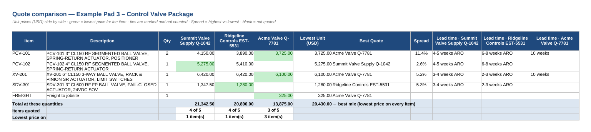
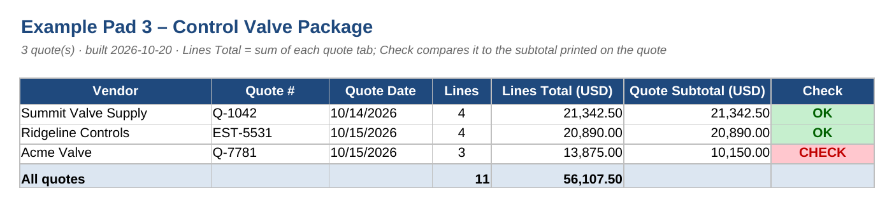
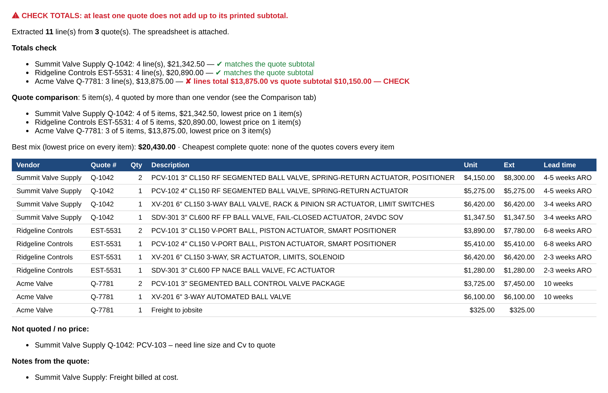
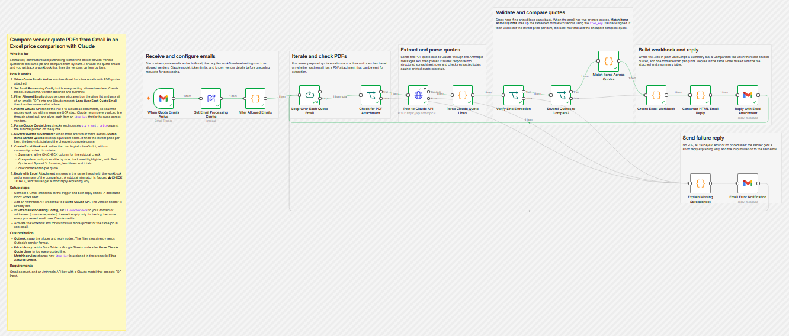
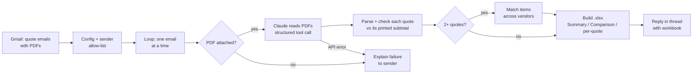

# Vendor Quote Comparison: n8n + Claude

An n8n workflow that turns vendor quote PDFs into a side-by-side price
comparison. Forward an email with several quotes for the same job, and a few
minutes later you get a reply in the same thread with an Excel workbook: every
quoted line extracted, each quote checked against its own printed subtotal, and
the vendors lined up item by item with the lowest price highlighted.

I built it out of my own estimating work in instrumentation & electrical
contracting, where comparing three vendors' valve packages by hand is an
afternoon of retyping and squinting.

Import `vendor-quote-comparison-workflow.json` into any n8n instance (Cloud or
self-hosted). It uses only built-in nodes. `sample/` holds a workbook built
from three example quotes, and `screenshots/` shows what comes back.

## What you get back

**Comparison tab:** unit prices side by side, lowest in green, best quote,
spread %, lead times, totals and a "best mix" total.

**Summary tab:** each quote's extracted lines checked against the subtotal
printed on the quote.

**Reply email:** the same story in the email body, with the workbook attached.

There is also one formatted tab per quote, with Extended = Qty × Unit as live
formulas.

## How it works

## The part that matters: five reliability decisions

An LLM can read a quote. The hard part is making sure a wrong number never
slips quietly into an estimate. These choices make the difference:

1. **Every quote is checked against itself.** The workflow adds up
   `qty × unit price` for each quote and compares it to the subtotal printed
   on that quote. A dropped line or misread price shows up as a red **CHECK**
   in the workbook and **⚠ CHECK TOTALS** at the top of the email. The sample
   shows it catching a quote that doesn't add up.

2. **The model extracts; code does the math.** Claude returns structured
   fields through a tool schema: qty, unit price, item key, lead time. Every
   total, comparison and "best quote" is computed in code and written as live
   Excel formulas. If someone edits a price in the sheet, the comparison
   recalculates.

3. **Matching happens while the model can see every quote.** Claude gets all
   of an email's PDFs in one request and assigns each item an `item_key` that
   is the same across vendors (the tag, else the part number). That matches
   "PCV-101" from three differently worded quotes reliably, which fuzzy
   text-matching after the fact does not.

4. **Gaps are shown, not hidden.** An item a vendor didn't quote is a blank
   cell, not a zero. "Items quoted: 3 of 5" is right on the sheet. Ties are
   marked and not counted as a win. Items a vendor listed without a price go
   in a "not quoted" list.

5. **Failures go back to whoever sent the email.** No PDF, an API error or
   nothing extractable: the sender gets a reply saying why, and the loop moves
   on to the next email. An allow-list keeps strangers from spending your API
   credits, and each email is processed on its own so a batch never mixes
   quotes.

## Setup

1. Import the workflow.
2. Connect a Gmail credential to the trigger and the two reply nodes. A
   dedicated inbox works best.
3. Add an Anthropic API credential to **Post to Claude API**.
4. In **Set Email Processing Config**, set `allowedSenders` (domains or
   addresses, comma-separated) and optionally `knownVendors` and `currency`.
   `claudeModel` must be a Claude model your key can use that accepts PDFs.
5. Activate the workflow and forward two or more quotes for the same job in
   one email.

To use Outlook, swap the trigger and reply nodes for Microsoft Outlook. The
filter step already reads Outlook's sender format.

## What a production version adds

The custom version I run for estimating fills a company's **existing** bid
spreadsheet instead of a new workbook. A small self-hosted service edits the
template's XML directly, so its logo, dropdowns, styles and formulas survive.
Each quote becomes its own tab, linked into the bid's totals sheet at qty 0 so
the estimator chooses which option to carry. That pattern of fitting an
automation into the spreadsheets a business already runs on, without breaking
them, is most of what clients actually need.

Other builds are described (sanitized) in
[n8n-resilient-reporting](https://github.com/brentvb1/n8n-resilient-reporting).

## License

MIT. See [LICENSE](LICENSE).
